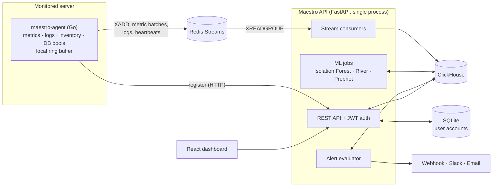

# 🎼 Maestro

[](https://github.com/yuriPeixoto/maestro/actions/workflows/ci.yml)
[](LICENSE)


[🇧🇷 Versão em português](./README.pt-BR.md)

Self-hosted observability for on-premise infrastructure. A lightweight Go agent collects metrics,
logs and inventory from each server and ships them through Redis Streams into ClickHouse. A FastAPI
backend evaluates alerts, runs ML anomaly detection and capacity forecasts, and serves a React
dashboard. No cloud services are involved: telemetry never leaves your infrastructure.

<!--
## Screenshots

Space reserved for dashboard screenshots (generated with the demo seeder).

-->

---

## Architecture



- **Agent → Redis Streams.** The agent batches metrics (50 per batch or every 5 s, whichever comes
  first) and publishes them with `XADD`. If Redis is unreachable, batches wait in a local ring buffer
  and are retried; on shutdown the agent flushes what it holds.
- **Redis Streams → ClickHouse.** The API reads the streams with consumer groups (`XREADGROUP`) and
  writes to ClickHouse `MergeTree` tables with per-table TTLs (90 days for metrics, 30 days for logs).
  Alert configuration lives in `ReplacingMergeTree` tables; user accounts live in SQLite.
- **Background work.** Stream consumers, the alert evaluator and the ML schedulers run as asyncio
  tasks inside the API process.

The reasoning behind each choice is recorded in the [architecture decision records](docs/adrs/).

---

## Features

**Collection (Go agent)**
- CPU, memory, disk I/O, disk space, network and process metrics, with Prometheus-style names
- Log file tailing (e.g. `auth.log`, `ufw.log`, application logs)
- Inventory of installed runtimes and services (Python, Node.js, PHP, Nginx and others) with versions
- Opt-in connection pool monitoring for MySQL/MariaDB, PostgreSQL and ClickHouse
- Heartbeats and server registration, YAML config with environment overrides, graceful shutdown

**Alerting**
- Static threshold rules and ML rules (fire on anomaly score, fall back to the threshold when no model exists)
- Deduplication and per-rule cooldown
- Notification channels: generic webhook, Slack and email (SMTP)

**Machine learning**
- Feature engineering (rolling statistics, rate of change, cyclic time features)
- Multivariate anomaly detection per server with Isolation Forest, plus online updates with River
- Capacity forecasting with Prophet ("disk full in N days" runway)
- Deploy/event impact analysis: before/after comparison of key metrics with a t-test (SciPy)

**Security signals**
- SSH failed logins and invalid users, top attackers and attacks by hour, parsed from `auth.log`
- UFW firewall summary and top blocked ports
- Known vulnerabilities for detected runtimes, from [OSV.dev](https://osv.dev)

**Dashboard (React)**
- Server list with online/offline status, per-server metric charts with anomaly markers,
  threshold lines and deploy annotations
- Infrastructure (database pools), Security, Alerts, Logs (live tail) and Capacity Planning views
- Multi-user accounts with profile and password reset
- English and Portuguese (pt-BR) interface

---

## Tech stack

| Component | Technology |
|-----------|------------|
| Agent | Go 1.27, single binary |
| API | Python 3.14, FastAPI, Pydantic |
| ML | scikit-learn, River, Prophet, pandas, SciPy |
| Storage | ClickHouse (telemetry), SQLite (user accounts) |
| Queue | Redis Streams |
| Frontend | React 19, TypeScript, Vite, Tailwind CSS, TanStack Query, Zustand, Apache ECharts |
| CI | GitHub Actions: Go vet/build/test, pytest, frontend build + lint |

---

## Getting started (local development)

### Option A: Docker Compose

Requires Docker Engine with Compose v2 (or Docker Desktop).

```bash
git clone https://github.com/yuriPeixoto/maestro.git
cd maestro

docker compose up                   # Redis, ClickHouse, API and frontend
docker compose --profile demo up    # same, plus the demo data seeder
```

| Service | Address |
|---------|---------|
| Frontend | http://localhost:5173 |
| API | http://localhost:8000 |
| API docs (OpenAPI) | http://localhost:8000/docs |
| ClickHouse (HTTP) | http://localhost:18123 |
| ClickHouse (native TCP) | localhost:19100 |
| Redis | localhost:16379 |

- ClickHouse migrations run automatically on first startup.
- Redis and ClickHouse use non-default host ports so the stack does not clash with a Redis or
  ClickHouse already running on your machine. Override them with `REDIS_HOST_PORT`,
  `CLICKHOUSE_HTTP_HOST_PORT` or `CLICKHOUSE_TCP_HOST_PORT` in your shell or in a `.env` file at
  the repository root.
- To point a locally built agent at this stack, run it with `MAESTRO_REDIS_ADDR=localhost:16379`.
- The first build takes a few minutes because of the Python ML dependencies; later starts use the
  cached image.

### Option B: manual setup

**Prerequisites:** Go 1.27, Python 3.14, Node.js 20.19+, a ClickHouse server and a Redis server.

```bash
# Agent
cd agent && go build -o maestro-agent ./cmd/agent

# API
cd api && python -m venv .venv
source .venv/bin/activate   # Windows: .venv\Scripts\activate
pip install -r requirements.txt
cp .env.example .env        # adjust values
uvicorn app.main:app --reload

# Frontend
cd frontend && npm install && npm run dev

# ClickHouse migrations (once)
for f in migrations/*.sql; do
  clickhouse-client --multiquery < "$f"
done
```

The agent reads its YAML config from `/etc/maestro/agent.yaml` by default (`-config` to change it); see
[`agent.yaml.example`](agent/configs/agent.yaml.example) and the [agent README](agent/README.md). Bare-metal deployment with systemd is described in
[docs/deployment.md](docs/deployment.md).

---

## Project structure

```
agent/       Go collector (single binary)
api/         FastAPI backend: ingestion, alerts, ML, REST API
frontend/    React dashboard
migrations/  ClickHouse SQL migrations
docs/        Roadmap, deployment guide, architecture decision records
```

---

## Planned

Not implemented yet. Progress is tracked in [docs/roadmap.md](docs/roadmap.md) and the issues.

- Cron job tracking with missed-run alerts ([#78](https://github.com/yuriPeixoto/maestro/issues/78))
- Deploy annotations from Orquestra ([#29](https://github.com/yuriPeixoto/maestro/issues/29))
- Log-pattern alert rules and an Aegis ticket dispatcher ([#85](https://github.com/yuriPeixoto/maestro/issues/85))
- URL routing in the dashboard, so alerts can deep-link to a chart
- Telegram notification channel
- ZSTD compression codecs on the ClickHouse tables
- A worker pool in the agent's publishing path
- A single ingestion contract for metrics and logs (OpenTelemetry/OTLP is the candidate)
- eBPF-based collectors
- Release binaries for the agent and published container images

---

## Contributing

Issues and pull requests are welcome. Before opening a PR, run the same checks as CI:

```bash
cd agent && go vet ./... && go test ./...
cd api && python -m pytest
cd frontend && npm run build && npm run lint
```

Commits follow [Conventional Commits](https://www.conventionalcommits.org/).

## License

[MIT](LICENSE) © 2026 Yuri Peixoto
