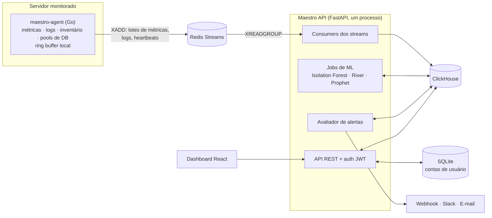

# 🎼 Maestro

[](https://github.com/yuriPeixoto/maestro/actions/workflows/ci.yml)
[](LICENSE)


[🇺🇸 English version (documentação principal)](./README.md)

Observabilidade self-hosted para infraestrutura on-premise. Um agente leve em Go coleta métricas, logs
e inventário de cada servidor e os envia, via Redis Streams, para o ClickHouse. Um backend em FastAPI
avalia alertas, roda detecção de anomalias e previsão de capacidade com machine learning e serve um
dashboard em React. Nenhum serviço de nuvem é usado: a telemetria nunca sai da sua infraestrutura.

<!--
## Prints

Espaço reservado para prints do dashboard (gerados com o seeder de demonstração).

-->

---

## Arquitetura



- **Agente → Redis Streams.** O agente agrupa as métricas em lotes (50 por lote ou a cada 5 s, o que
  vier primeiro) e as publica com `XADD`. Se o Redis estiver fora do ar, os lotes esperam num ring
  buffer local e são reenviados; ao desligar, o agente descarrega o que tem guardado.
- **Redis Streams → ClickHouse.** A API lê os streams com consumer groups (`XREADGROUP`) e grava em
  tabelas `MergeTree` do ClickHouse com TTL por tabela (90 dias para métricas, 30 dias para logs).
  A configuração de alertas fica em tabelas `ReplacingMergeTree`; as contas de usuário, no SQLite.
- **Trabalho em segundo plano.** Os consumers, o avaliador de alertas e os jobs de ML rodam como
  tarefas asyncio dentro do processo da API.

O porquê de cada escolha está registrado nas [decisões de arquitetura (ADRs)](docs/adrs/).

---

## Funcionalidades

**Coleta (agente em Go)**
- Métricas de CPU, memória, I/O e espaço em disco, rede e processos, com nomes no padrão Prometheus
- Leitura contínua de arquivos de log (por exemplo `auth.log`, `ufw.log` e logs de aplicação)
- Inventário de runtimes e serviços instalados (Python, Node.js, PHP, Nginx, Apache, OpenSSH e outros), com versões
- Lista dos pacotes do sistema no Debian, enviada a cada 6 horas para o scan de vulnerabilidades
- Monitoramento opcional de pools de conexão de MySQL/MariaDB, PostgreSQL e ClickHouse
- Heartbeats, configuração em YAML com sobrescrita por variáveis de ambiente, desligamento gracioso

**Alertas**
- Regras por limite estático e regras de ML (disparam pelo score de anomalia e voltam ao limite
  quando ainda não há modelo)
- Deduplicação e cooldown por regra
- Canais de notificação: webhook genérico, Slack e e-mail (SMTP)

**Machine learning**
- Engenharia de features (estatísticas móveis, taxa de variação, features cíclicas de tempo)
- Detecção multivariada de anomalias por servidor com Isolation Forest, e atualização online com River
- Previsão de capacidade com Prophet ("disco cheio em N dias")
- Impacto de deploys e eventos: comparação antes/depois das métricas principais com teste t (SciPy)

**Sinais de segurança**
- Falhas de login SSH e usuários inválidos, principais atacantes e ataques por hora, a partir do `auth.log`
- Resumo do firewall UFW e portas mais bloqueadas
- Vulnerabilidades conhecidas dos runtimes detectados, via [OSV.dev](https://osv.dev)
- Scan dos pacotes Debian contra os avisos do OSV.dev: as versões são comparadas pelas regras do próprio
  Debian, o que respeita correções em backport, e só entram vulnerabilidades com correção publicada, com
  severidade CVSS

**Dashboard (React)**
- Lista de servidores com status online/offline; gráficos por servidor com marcação de anomalias,
  linhas de limite e anotações de deploy e eventos (os eventos são enviados à API REST)
- Telas de Infraestrutura (pools de banco), Segurança, Alertas, Logs (em tempo real) e Capacity Planning
- Várias contas de usuário, com perfil, redefinição de senha, troca obrigatória no primeiro login e
  limite de tentativas de login (5 falhas a cada 15 minutos)
- Interface em inglês e português

---

## Stack

| Componente | Tecnologia |
|------------|------------|
| Agente | Go 1.27, binário único |
| API | Python 3.14, FastAPI, Pydantic |
| ML | scikit-learn, River, Prophet, pandas, SciPy |
| Armazenamento | ClickHouse (telemetria), SQLite (contas de usuário) |
| Fila | Redis Streams |
| Frontend | React 19, TypeScript, Vite, Tailwind CSS, TanStack Query, Zustand, Apache ECharts |
| CI | GitHub Actions: vet/build/test do Go, pytest, build + lint do frontend |

---

## Como rodar (desenvolvimento local)

### Opção A: Docker Compose

Requer Docker Engine com Compose v2 (ou Docker Desktop).

```bash
git clone https://github.com/yuriPeixoto/maestro.git
cd maestro

docker compose up                   # Redis, ClickHouse, API e frontend
docker compose --profile demo up    # o mesmo, mais o seeder de dados de demonstração
```

| Serviço | Endereço |
|---------|----------|
| Frontend | http://localhost:5173 |
| API | http://localhost:8000 |
| Documentação da API (OpenAPI) | http://localhost:8000/docs |
| ClickHouse (HTTP) | http://localhost:18123 |
| ClickHouse (TCP nativo) | localhost:19100 |
| Redis | localhost:16379 |

- As migrations do ClickHouse rodam sozinhas na primeira subida.
- O Redis e o ClickHouse usam portas diferentes das padrão no host, para não conflitar com um Redis ou
  ClickHouse que já esteja rodando na sua máquina. Para trocá-las, defina `REDIS_HOST_PORT`,
  `CLICKHOUSE_HTTP_HOST_PORT` ou `CLICKHOUSE_TCP_HOST_PORT` no shell ou num arquivo `.env` na raiz
  do repositório.
- Para apontar um agente compilado localmente para essa stack, rode-o com
  `MAESTRO_REDIS_ADDR=localhost:16379`.
- O primeiro build leva alguns minutos por causa das dependências de ML do Python; as subidas
  seguintes usam a imagem em cache.

### Opção B: instalação manual

**Pré-requisitos:** Go 1.27, Python 3.14, Node.js 20.19+, um servidor ClickHouse e um servidor Redis.

```bash
# Agente
cd agent && go build -o maestro-agent ./cmd/agent

# API
cd api && python -m venv .venv
source .venv/bin/activate   # Windows: .venv\Scripts\activate
pip install -r requirements.txt
cp .env.example .env        # ajuste os valores
uvicorn app.main:app --reload

# Frontend
cd frontend && npm install && npm run dev

# Migrations do ClickHouse (uma vez)
for f in migrations/*.sql; do
  clickhouse-client --multiquery < "$f"
done
```

Por padrão, o agente lê a configuração YAML em `/etc/maestro/agent.yaml` (use `-config` para mudar);
veja o [`agent.yaml.example`](agent/configs/agent.yaml.example) e o [README do agente](agent/README.md).
A instalação em servidor (nginx ou Apache, systemd ou supervisor) está em [docs/deployment.md](docs/deployment.md).

---

## Estrutura do projeto

```
agent/       Coletor em Go (binário único)
api/         Backend FastAPI: ingestão, alertas, ML, API REST
frontend/    Dashboard em React
migrations/  Migrations SQL do ClickHouse
docs/        Roadmap, guia de deploy, decisões de arquitetura
```

---

## Planejado

Ainda não implementado. O andamento fica em [docs/roadmap.md](docs/roadmap.md) e nas issues.

- Autenticação de máquina para agentes e tarefas agendadas; hoje todo endpoint de ingestão da API exige login de usuário
- Monitoramento de cron jobs com alerta de execução perdida ([#78](https://github.com/yuriPeixoto/maestro/issues/78))
- Orquestra como fonte automática de eventos de deploy para as anotações dos gráficos ([#29](https://github.com/yuriPeixoto/maestro/issues/29))
- Regras de alerta por padrão de log e envio de tickets ao Aegis ([#85](https://github.com/yuriPeixoto/maestro/issues/85))
- Redefinição de senha pelo administrador na tela de Usuários ([#99](https://github.com/yuriPeixoto/maestro/issues/99))
- Rotas de URL no dashboard, para que um alerta possa apontar direto para um gráfico
- Canal de notificação pelo Telegram
- Compressão ZSTD nas tabelas do ClickHouse
- Worker pool no envio do agente
- Um contrato único de ingestão para métricas e logs (OpenTelemetry/OTLP é o candidato)
- Coletores baseados em eBPF
- Binários do agente para download e imagens de container publicadas

---

## Contribuindo

Issues e pull requests são bem-vindos. Antes de abrir um PR, rode as mesmas verificações do CI:

```bash
cd agent && go vet ./... && go test ./...
cd api && python -m pytest
cd frontend && npm run build && npm run lint
```

Os commits seguem o [Conventional Commits](https://www.conventionalcommits.org/).

## Licença

[MIT](LICENSE) © 2026 Yuri Peixoto
